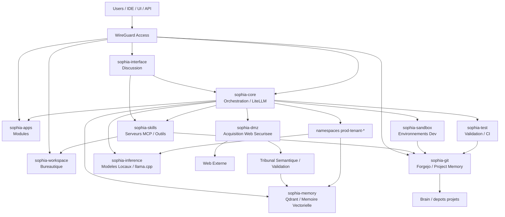

# SOPHIA

**Sovereign Orchestrator Platform for Holistic Intelligence Architecture**

SophIA est une architecture ouverte conque pour aider les organisations a utiliser l'intelligence artificielle tout en preservant le controle de leurs donnees, de leurs modeles et de leur infrastructure.

Le projet explore comment des composants open-source peuvent etre assembles en une plateforme coherente et securisee pour deployer, orchestrer et gouverner des systemes d'IA.

---

## Pourquoi SophIA

L'adoption de l'intelligence artificielle s'accelere rapidement, mais de nombreuses organisations font face a des defis critiques :

- Perte de controle sur les donnees
- Dependance envers des plateformes proprietaires
- Risques de securite lors des interactions avec des modeles externes
- Gouvernance limitee des flux de travail IA
- Outillage fragmente autour des modeles, agents et systemes de connaissance

SophIA vise a repondre a ces defis en proposant une architecture souveraine, modulaire et ouverte.

---

## Objectifs du projet

SophIA se concentre sur plusieurs principes fondamentaux :

- **Souverainete.** Maintenir un controle total sur les donnees, l'infrastructure et les modeles.
- **Securite.** Proteger les systemes contre les fuites de donnees et les interactions non securisees avec les modeles.
- **Orchestration.** Fournir une maniere structuree de combiner modeles, agents, outils et systemes de connaissance.
- **Modularite.** Assembler des composants open-source existants en une architecture coherente.
- **Reproductibilite.** Garantir que les deploiements peuvent etre reproduits et audites.

---

## Vue d'ensemble de l'architecture

SophIA integre plusieurs technologies open-source dans une architecture unifiee.

La stack experimentale actuelle inclut :

- **OKD / Kubernetes** : orchestration infrastructurelle
- **LiteLLM** : couche de routage de modeles unifiee
- **llama.cpp** : execution locale du modele de langage, vision comprise (GPU) ; voix et generation d'images sur CPU
- **Keycloak** : identite et SSO de toutes les interfaces
- **RabbitMQ** et **Temporal** : evenements et workflows durables des agents
- **Serveurs MCP** : outils locaux (geographie, images) et sas web
- **Qdrant** : base vectorielle pour les systemes RAG
- **Forgejo** : versionnement de la memoire et de la documentation du projet

Concepts architecturaux complementaires explores :

- couches d'acquisition web securisees
- pipelines de validation semantique
- environnements de travail controles pour les agents IA
- orchestration centree sur le projet

Plus de details sont disponibles dans la documentation.

---

## Statut du projet

SophIA est actuellement un projet d'architecture experimentale.

Etape actuelle :

- plateforme centrale en service dans l'installation de reference (inference locale, routeur de modeles, SSO, discussion, bureautique, bus et workflows, agents sur le modele local, observabilite) ; agents et memoire en cours — voir [Où en est le projet](docs/pitch.md) et la [feuille de route](docs/roadmap.md)
- documentation architecturale en cours
- livre blanc en preparation
- structure du depot public en cours d'etablissement

Le projet vise a evoluer vers une architecture de reference pour les infrastructures d'IA souveraines.

---

## Documentation

La documentation est organisee dans le repertoire [`docs/`](docs/index.md).

- **[Pitch](docs/pitch.md)** — SophIA en une phrase, 30 secondes et 3 minutes
- **[Périmètre fonctionnel](docs/functional-scope.md)** — Ce que SophIA doit faire et pour qui, avec l'état de chaque fonction
- **[Architecture](docs/architecture.md)** — Principes, composants et organisation haut niveau
- **[Securite](docs/security.md)** — Modele de securite et isolation
- **[Vision](docs/vision.md)** — Objectifs et motivations du projet
- **[Roadmap](docs/roadmap.md)** — Etapes et planification
- **[Glossaire](docs/glossary.md)** — Lexique des termes

### Concepts architecturaux (12 fiches)

| Concept | Description |
|---------|-------------|
| [Project Model](docs/concepts/00-project-model.md) | Modele de gestion de projet et espaces de travail |
| [Context Management](docs/concepts/01-context-management.md) | Gestion du contexte pour les interactions avec les modeles |
| [Workspace Management](docs/concepts/02-workspace-management.md) | Isolation et gestion des environnements de travail |
| [RAG 5D](docs/concepts/03-rag-5d.md) | Topologie de la connaissance en cinq dimensions |
| [Sas Paranoiaque](docs/concepts/04-sas-paranoiaque.md) | Acquisition web isolee et securisee |
| [Tribunal Semantique](docs/concepts/05-tribunal-semantique.md) | Validation de confiance avant ingestion RAG |
| [Ghost Search](docs/concepts/06-ghost-search.md) | Requetes leurres pour masquer les intentions |
| [DLP Filter](docs/concepts/07-dlp-filter.md) | Detection et blocage des fuites de donnees |
| [Pantheon Agentique](docs/concepts/08-pantheon-agentique.md) | Agents specialises, confinement et isolation |
| [Automation Déterministe](docs/concepts/09-automation-deterministe.md) | Le code orchestre, le modèle réfléchit, les règles décident |
| [Observabilité](docs/concepts/10-observabilite.md) | Alarmes, workflow « incident », validation humaine |
| [Inférence et matériel](docs/concepts/11-inference-materiel.md) | Une carte par famille de tâches, partage et priorité, budget CPU |
| [Relais de l'identité](docs/concepts/12-relais-identite.md) | Un outil MCP agit sous l'identité de la personne : relais, vérification et échange du jeton |
| [Modèles par rôle](docs/concepts/13-modeles-par-role.md) | Modèle imposé par le serveur selon le rôle, une clé virtuelle par usage, clé maître confinée au routeur |

### Deploiement

- [Exemple de deploiement](deploy/README.md) — Configuration OKD de reference
- [Infrastructure POC](deploy/infrastructure.md) — Specification du Proof of Concept

---

## Livre blanc

Un livre blanc technique decrivant l'architecture et ses motivations est actuellement en preparation.

---

## Contribution

Les contributions, discussions et retours sont les bienvenus. Le projet en est a un stade precoce et est ouvert aux idees des ingenieurs, chercheurs et specialistes de l'infrastructure interesses par les architectures d'IA souveraines.

---

## Auteur

Projet initie par **Damien Guesdon**.

Avec plus de 20 ans d'experience en infrastructure, reseaux et architecture systeme, et une specialisation en cours en ingenierie de l'intelligence artificielle.

---

## Licence

Apache License 2.0

---

Site officiel : https://sophia.kisai.fr
