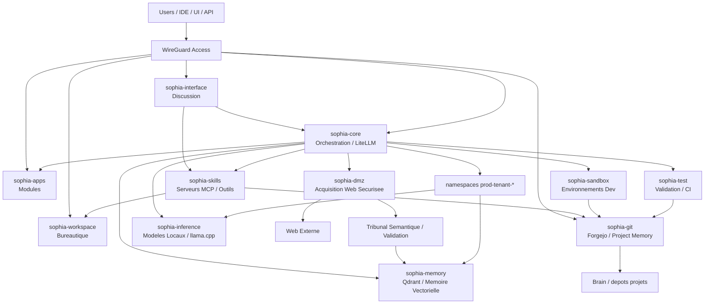

# SOPHIA

**Sovereign Orchestrator Platform for Holistic Intelligence Architecture**

SophIA est une architecture ouverte conque pour aider les organisations à utiliser l'intelligence artificielle tout en préservant le contrôle de leurs données, de leurs modèles et de leur infrastructure.

Le projet explore comment des composants open-source peuvent être assemblés en une plateforme cohérente et sécurisée pour déployer, orchestrer et gouverner des systèmes d'IA.

---

## Pourquoi SophIA

L'adoption de l'intelligence artificielle s'accélère rapidement, mais de nombreuses organisations font face à des défis critiques :

- Perte de contrôle sur les données
- Dépendance envers des plateformes propriétaires
- Risques de sécurité lors des interactions avec des modèles externes
- Gouvernance limitée des flux de travail IA
- Outillage fragmenté autour des modèles, agents et systèmes de connaissance

SophIA vise à répondre à ces défis en proposant une architecture souveraine, modulaire et ouverte.

---

## Objectifs du projet

SophIA se concentre sur plusieurs principes fondamentaux :

- **Souveraineté.** Maintenir un contrôle total sur les données, l'infrastructure et les modèles.
- **Sécurité.** Protéger les systèmes contre les fuites de données et les interactions non sécurisées avec les modèles.
- **Orchestration.** Fournir une manière structurée de combiner modèles, agents, outils et systèmes de connaissance.
- **Modularité.** Assembler des composants open-source existants en une architecture cohérente.
- **Reproductibilité.** Garantir que les déploiements peuvent être reproduits et audités.

---

## Vue d'ensemble de l'architecture

SophIA intègre plusieurs technologies open-source dans une architecture unifiée.

La stack expérimentale actuelle inclut :

- **OKD / Kubernetes** : orchestration infrastructurelle
- **LiteLLM** : couche de routage de modèles unifiée
- **llama.cpp** : exécution locale du modèle de langage, vision comprise (GPU) ; voix et génération d'images sur CPU
- **Keycloak** : identité et SSO de toutes les interfaces
- **RabbitMQ** et **Temporal** : événements et workflows durables des agents
- **Serveurs MCP** : outils locaux (géographie, images) et sas web
- **Qdrant** : base vectorielle pour les systèmes RAG
- **Forgejo** : versionnement de la mémoire et de la documentation du projet

Concepts architecturaux complémentaires explorés :

- couches d'acquisition web sécurisées
- pipelines de validation sémantique
- environnements de travail contrôlés pour les agents IA
- orchestration centrée sur le projet

Plus de détails sont disponibles dans la documentation.

---

## Statut du projet

SophIA est actuellement un projet d'architecture expérimentale.

Étape actuelle :

- plateforme centrale en service dans l'installation de référence (inférence locale, routeur de modèles, SSO, discussion, bureautique, bus et workflows, agents sur le modèle local, observabilité et alertes) ; dashboard : la discussion affiche les applications au centre (en partie en recette) ; chat permanent et visio du foyer en service, en recette ; agents et mémoire en cours — voir [Où en est le projet](docs/pitch.md) et la [feuille de route](docs/roadmap.md)
- documentation architecturale en cours
- livre blanc en préparation
- structure du dépôt public en cours d'établissement

Le projet vise à évoluer vers une architecture de référence pour les infrastructures d'IA souveraines.

---

## Documentation

La documentation est organisée dans le répertoire [`docs/`](docs/index.md).

- **[Pitch](docs/pitch.md)** — SophIA en une phrase, 30 secondes et 3 minutes
- **[Périmètre fonctionnel](docs/functional-scope.md)** — Ce que SophIA doit faire et pour qui, avec l'état de chaque fonction
- **[Architecture](docs/architecture.md)** — Principes, composants et organisation haut niveau
- **[Sécurité](docs/security.md)** — Modèle de sécurité et isolation
- **[Vision](docs/vision.md)** — Objectifs et motivations du projet
- **[Roadmap](docs/roadmap.md)** — Étapes et planification
- **[Glossaire](docs/glossary.md)** — Lexique des termes

### Concepts architecturaux (12 fiches)

| Concept | Description |
|---------|-------------|
| [Project Model](docs/concepts/00-project-model.md) | Modèle de gestion de projet et espaces de travail |
| [Context Management](docs/concepts/01-context-management.md) | Gestion du contexte pour les interactions avec les modèles |
| [Workspace Management](docs/concepts/02-workspace-management.md) | Isolation et gestion des environnements de travail |
| [RAG 5D](docs/concepts/03-rag-5d.md) | Topologie de la connaissance en cinq dimensions |
| [Sas Paranoïaque](docs/concepts/04-sas-paranoiaque.md) | Acquisition web isolée et sécurisée |
| [Tribunal Sémantique](docs/concepts/05-tribunal-semantique.md) | Validation de confiance avant ingestion RAG |
| [Ghost Search](docs/concepts/06-ghost-search.md) | Requêtes leurres pour masquer les intentions |
| [DLP Filter](docs/concepts/07-dlp-filter.md) | Détection et blocage des fuites de données |
| [Panthéon Agentique](docs/concepts/08-pantheon-agentique.md) | Agents spécialisés, confinement et isolation |
| [Automation Déterministe](docs/concepts/09-automation-deterministe.md) | Le code orchestre, le modèle réfléchit, les règles décident |
| [Observabilité](docs/concepts/10-observabilite.md) | Alarmes, workflow « incident », validation humaine |
| [Inférence et matériel](docs/concepts/11-inference-materiel.md) | Une carte par famille de tâches, partage et priorité, budget CPU |
| [Relais de l'identité](docs/concepts/12-relais-identite.md) | Un outil MCP agit sous l'identité de la personne : relais, vérification et échange du jeton |
| [Modèles par rôle](docs/concepts/13-modeles-par-role.md) | Modèle imposé par le serveur selon le rôle, une clé virtuelle par usage, clé maître confinée au routeur |

### Déploiement

- [Exemple de déploiement](deploy/README.md) — Configuration OKD de référence
- [Infrastructure POC](deploy/infrastructure.md) — Spécification du Proof of Concept

---

## Livre blanc

Un livre blanc technique décrivant l'architecture et ses motivations est actuellement en préparation.

---

## Contribution

Les contributions, discussions et retours sont les bienvenus. Le projet en est à un stade précoce et est ouvert aux idées des ingénieurs, chercheurs et spécialistes de l'infrastructure intéressés par les architectures d'IA souveraines.

---

## Auteur

Projet initié par **Damien Guesdon**.

Avec plus de 20 ans d'expérience en infrastructure, réseaux et architecture système, et une spécialisation en cours en ingénierie de l'intelligence artificielle.

---

## Licence

Apache License 2.0

---

Site officiel : https://sophia.kisai.fr
